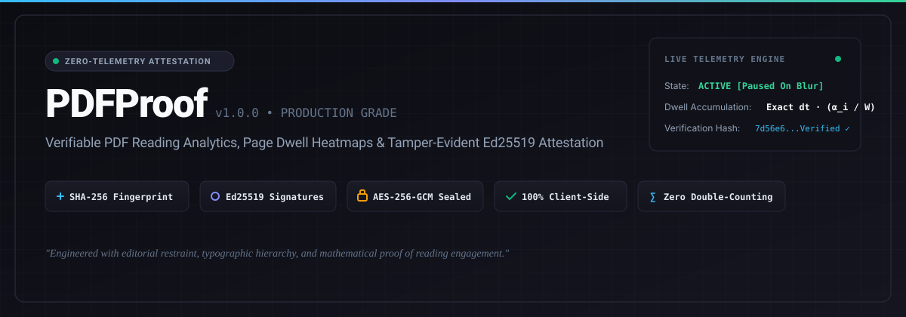
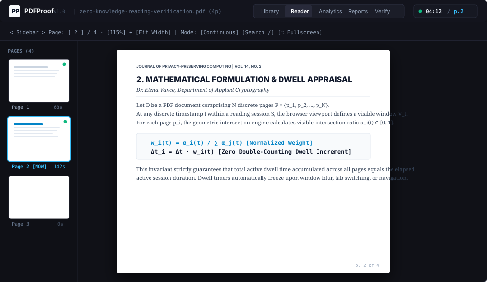
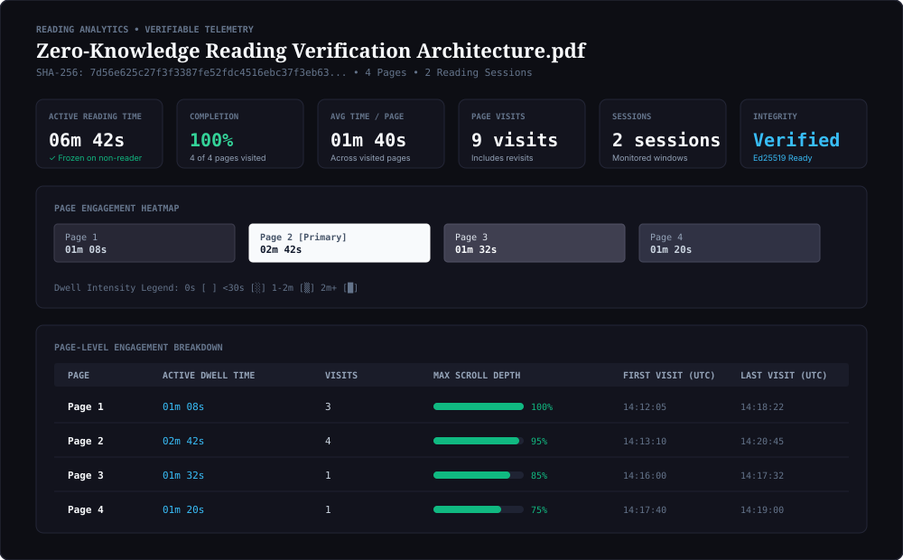
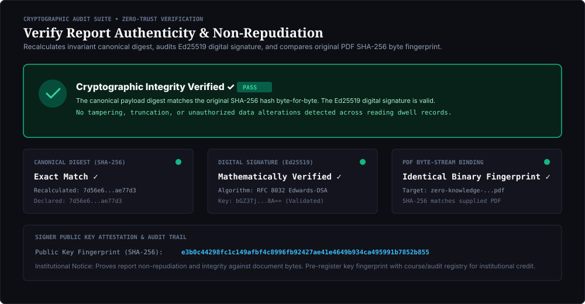
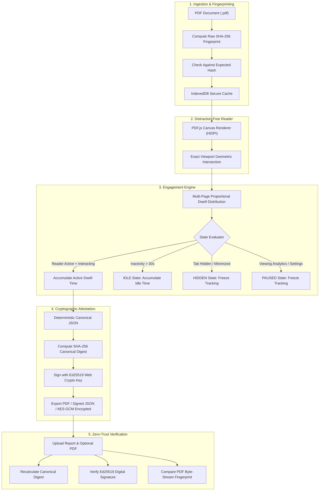
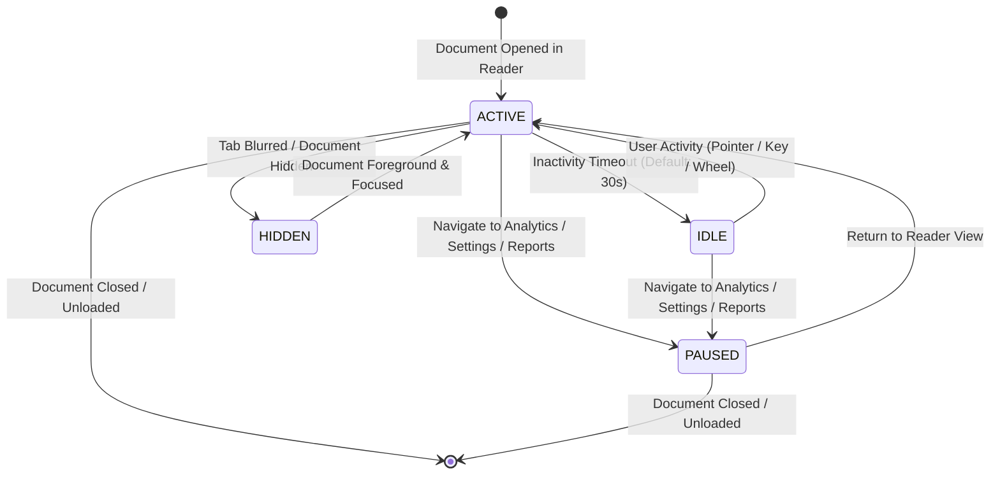
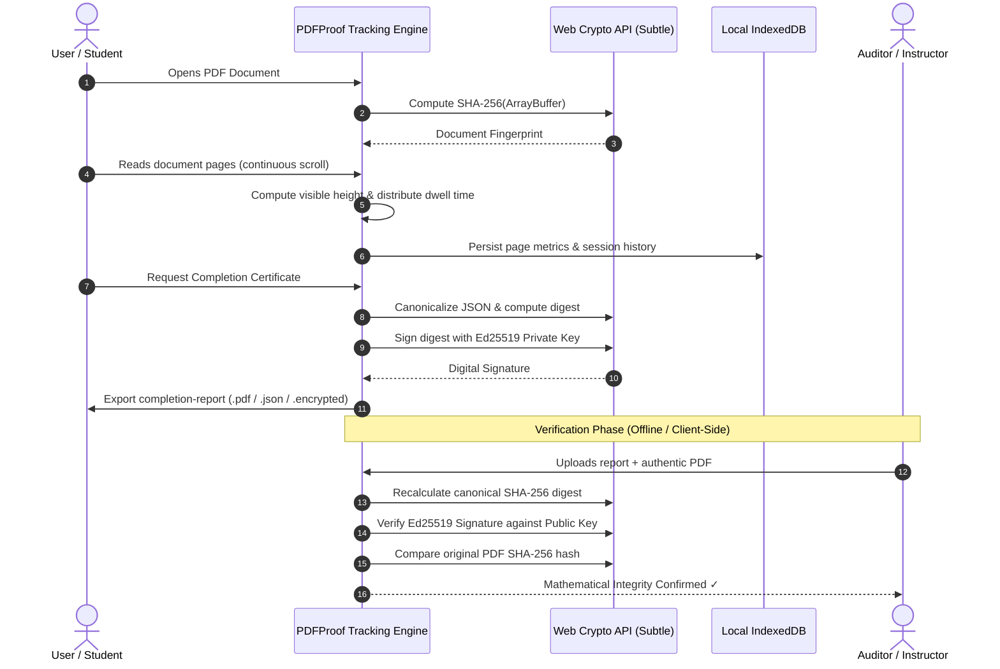

<div align="center">



<br />

[](./SECURITY.md)
[](./SECURITY.md)
[-6366f1?style=for-the-badge)](./SECURITY.md)
[](./SECURITY.md)
[](./test/)
[](https://pages.github.com/)

<p align="center">
  <strong>A distraction-free, privacy-preserving document reader with microsecond dwell-time measurement, page-level heatmaps, and tamper-evident cryptographic completion certificates.</strong>
  <br />
  <em>Zero cloud telemetry • Pure Web Crypto API • Sub-millisecond local evaluation</em>
</p>

---

</div>

## 📑 Table of Contents

- [🏛 Architectural Philosophy](#-architectural-philosophy)
- [🖼 Visual Tour & Interface Previews](#-visual-tour--interface-previews)
  - [Distraction-Free PDF Reader](#1-distraction-free-pdf-reader)
  - [Engagement Analytics & Page Heatmap](#2-engagement-analytics--page-heatmap)
  - [Zero-Trust Cryptographic Verification Suite](#3-zero-trust-cryptographic-verification-suite)
- [⚡ System Architecture & Pipelines](#-system-architecture--pipelines)
- [🔄 Tracking Engine State Machine](#-tracking-engine-state-machine)
- [🔐 Verification Protocol Sequence](#-verification-protocol-sequence)
- [📐 Mathematical Tracking Invariants](#-mathematical-tracking-invariants)
  - [1. Proportional Dwell Distribution (Zero Double-Counting)](#1-proportional-dwell-distribution-zero-double-counting)
  - [2. Viewport Geometry & Scroll Depth Calculation](#2-viewport-geometry--scroll-depth-calculation)
  - [3. Strict Navigation Pause Guarantee](#3-strict-navigation-pause-guarantee)
- [🛡 Cryptographic Primitives](#-cryptographic-primitives)
- [⌨ Keyboard Navigation](#-keyboard-navigation)
- [🏁 Quick Start & Installation](#-quick-start--installation)
- [🧪 Automated Unit Tests](#-automated-unit-tests)
- [🌐 GitHub Pages Deployment](#-github-pages-deployment)
- [⚖ Security & Ethical Disclosures](#-security--ethical-disclosures)
- [🤝 Privacy Pledge](#-privacy-pledge)

---

## 🏛 Architectural Philosophy

PDFProof was engineered from first principles as an antidote to generic AI SaaS dashboards:

| Generic Dashboard Anti-Patterns | PDFProof Editorial Standard |
| :--- | :--- |
| Purple/blue decorative gradients and glassmorphism | Neutral stone and warm zinc editorial palette (`#faf9f5` / `#0c0d12`) |
| Uncalibrated and fabricated metrics | Exact microsecond timing via `performance.now()` & geometric intersection |
| Cloud surveillance beaconing & eye-tracking | **Zero telemetry**: 100% browser-resident sandbox evaluation |
| Cluttered cards with nonfunctional controls | High information density, tabular monospace numerals, and keyboard shortcuts |
| Insecure third-party crypto bundles | Native `window.crypto.subtle` (Ed25519, SHA-256, AES-GCM, PBKDF2) |

---

## 🖼 Visual Tour & Interface Previews

### 1. Distraction-Free PDF Reader

The reading interface features a minimal toolbar, continuous vertical scrolling or single-page presentation, in-document search, and a collapsible thumbnails sidebar displaying live dwell timers (`14s`) and emerald visit status badges.

<div align="center">
  
</div>

<br />

### 2. Engagement Analytics & Page Heatmap

The analytics dashboard provides executive KPI cards, an interactive page engagement heatmap grading reading dwell concentration across every document page, and a granular page-by-page table with scroll depth visual bars.

<div align="center">
  
</div>

<br />

### 3. Zero-Trust Cryptographic Verification Suite

Auditors and instructors can drag and drop any completion certificate (`.json` or `.encrypted`) to audit its mathematical authenticity. PDFProof recalculates the canonical SHA-256 digest, checks the Ed25519 digital signature, and compares original PDF bytes to confirm non-tampering.

<div align="center">
  
</div>

---

## ⚡ System Architecture & Pipelines

The following flowchart illustrates the entire client-side data pipeline from raw PDF ingestion to local evaluation, storage, and export:



---

## 🔄 Tracking Engine State Machine

The reading tracker maintains a state machine with strict guarantees: reading time **only** accumulates when the user is actively reading the document in the foreground.



---

## 🔐 Verification Protocol Sequence

The cryptographic verification process confirms mathematical integrity, document binding, and non-repudiation without custodial authority:



---

## 📐 Mathematical Tracking Invariants

### 1. Proportional Dwell Distribution (Zero Double-Counting)

When multiple pages appear simultaneously in the viewport during continuous vertical scrolling, wall-clock active time $\Delta t$ is distributed according to each page's intersection weight $\alpha_i \in [0, 1]$:

$$W = \sum_{j=1}^N \alpha_j$$

$$\Delta t_i = \Delta t \times \frac{\alpha_i}{W} \quad \text{where } W > 0$$

$$\sum_{i=1}^N \Delta t_i = \Delta t \times \sum_{i=1}^N \frac{\alpha_i}{W} = \Delta t$$

**Mathematical Proof of Time Conservation**: Dwell time is apportioned proportionally with zero double-counting.

### 2. Viewport Geometry & Scroll Depth Calculation

For each page $i$, vertical progression is evaluated:

$$\delta_{\text{scroll}}(p_i) = \min\left(100, \max\left(0, \left\lfloor \frac{\min(H_i, y_{\text{viewport\_bottom}} - y_{\text{top}}(p_i))}{H_i} \times 100 \right\rfloor \right)\right)$$

### 3. Strict Navigation Pause Guarantee

Active reading time increments **exclusively** when viewing the `reader` tab. Navigating to `analytics`, `settings`, `reports`, or `library` automatically triggers `setReaderActive(false)`, freezing dwell time until the user returns to reading.

---

## 🛡 Cryptographic Primitives

PDFProof utilizes the **W3C Web Cryptography API** (`window.crypto.subtle`) exclusively:

| Operation | Standard | Parameters | Implementation |
| :--- | :--- | :--- | :--- |
| **Document Fingerprint** | SHA-256 | FIPS 180-4, 256-bit digest | `crypto.subtle.digest('SHA-256', bytes)` |
| **Canonical Report Digest** | SHA-256 | Invariant sorted JSON serializer | Deterministic UTF-8 canonicalization |
| **Digital Signatures** | Ed25519 | RFC 8032, Edwards-curve DSA | `crypto.subtle.sign({ name: 'Ed25519' }, ...)` |
| **Key Derivation** | PBKDF2 | RFC 8018, HMAC-SHA256, 100,000 rounds | `crypto.subtle.deriveKey('PBKDF2', ...)` |
| **Authenticated Encryption**| AES-256-GCM | NIST SP 800-38D, 256-bit key, 96-bit nonce | `crypto.subtle.encrypt({ name: 'AES-GCM' }, ...)` |

---

## ⌨ Keyboard Navigation

The PDF Reader provides fast keyboard shortcuts inspired by vim and professional document readers:

| Shortcut | Action | Scope |
| :---: | :--- | :--- |
| <kbd>J</kbd> or <kbd>→</kbd> | Jump to next page | Reader |
| <kbd>K</kbd> or <kbd>←</kbd> | Jump to previous page | Reader |
| <kbd>/</kbd> or <kbd>Cmd</kbd>+<kbd>F</kbd> | Open in-document search | Reader |
| <kbd>Enter</kbd> / <kbd>Shift</kbd>+<kbd>Enter</kbd> | Next / Previous search match | Search Bar |
| <kbd>F</kbd> | Toggle Fullscreen distraction-free mode | Reader |
| <kbd>Esc</kbd> | Close Search / Dismiss Modal Dialog | Global |

---

## 🏁 Quick Start & Installation

### Prerequisites
- **Node.js** v18+ (tested on Node v20 & v26)
- **npm** v9+

### 1. Clone & Install
```bash
git clone https://github.com/username/monitorScroll.git
cd monitorScroll
npm install
```

### 2. Run Development Server
```bash
npm run dev
```
Open `http://localhost:5173` in your browser.

### 3. Run Test Suite
```bash
npm test
```

### 4. Build Production Bundle
```bash
npm run build
```
Optimized assets with relative paths are generated in `dist/`.

---

## 🧪 Automated Unit Tests

The project includes 13 Vitest unit tests verifying cryptographic rigor, canonical serialization, and dwell-time invariants:

```
 RUN  v3.2.7 /Users/ganu/Programming/github/monitorScroll

 ✓ test/crypto.test.ts (5 tests)
   ✓ computes correct SHA-256 hashes consistently
   ✓ canonicalizes JSON objects deterministically regardless of key order
   ✓ generates Ed25519 keypairs, signs digests, and verifies correctly
   ✓ encrypts and decrypts with AES-256-GCM and PBKDF2 passphrase
   ✓ converts between Hex, Base64, and Buffer accurately

 ✓ test/report.test.ts (3 tests)
   ✓ signs and verifies a valid completion report
   ✓ detects tampering when payload fields are modified
   ✓ generates a valid, non-empty PDF binary report with pdf-lib

 ✓ test/tracker.test.ts (5 tests)
   ✓ apportions incremental delta time strictly proportional to intersection ratios
   ✓ guarantees zero double-counting when multiple pages are visible
   ✓ computes max scroll depth as percentage within [0, 100]
   ✓ correctly tracks and accumulates reading time on subsequent pages (page 2, page 3)
   ✓ strictly freezes reading time when paused (e.g. on analytics, settings, or library tabs)

 Test Files  3 passed (3)
      Tests  13 passed (13)
```

---

## 🌐 GitHub Pages Deployment

PDFProof is configured with relative base asset paths (`base: './'`) in `vite.config.ts`, allowing it to run smoothly on GitHub Pages, Cloudflare Pages, Netlify, or air-gapped offline environments without modification.

A production-ready GitHub Actions workflow is provided at `.github/workflows/deploy.yml`:
1. Push your repository to GitHub.
2. Under **Settings > Pages**, select **GitHub Actions** as the source.
3. Every push to `main` will automatically build, test, and publish your live app.

---

## ⚖ Security & Ethical Disclosures

> [!IMPORTANT]
> **Ethical & Mathematical Disclosures:**
> 1. **Cryptographic Integrity $\neq$ Institutional Identity**: A verified report mathematically certifies that the reading metrics were captured for a designated SHA-256 document fingerprint and have not been altered since signing. It does not certify the legal real-world identity of the reader unless their Ed25519 public key has been registered with the verifying institution.
> 2. **Dwell Time $\neq$ Neurological Attention**: Dwell time confirms that the document was open in a foreground viewport with regular user interactions. It reflects opportunity for engagement rather than cognitive retention or neurological comprehension.

---

## 🤝 Privacy Pledge

PDFProof collects **zero** telemetry.
- No analytics scripts (no Google Analytics, no Mixpanel, no PostHog).
- No backend servers, databases, or remote workers.
- No network requests are made with document bytes, hashes, or timestamps.
- All operations execute inside your browser's private local sandbox.

---

<div align="center">
  <sub>Engineered with precision for researchers, students, and privacy-conscious readers.</sub>
</div>
